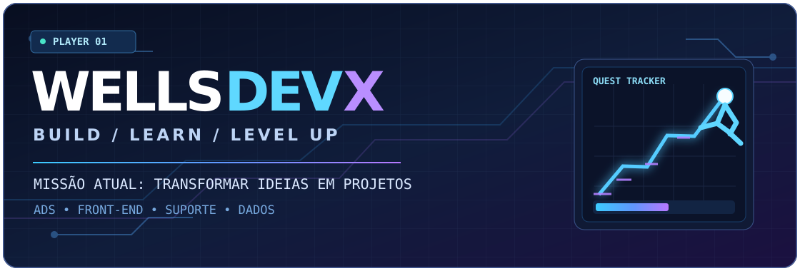

<div align="center">



### 🎮 PLAYER ONE: WELDER VIANA

**Estudante de Análise e Desenvolvimento de Sistemas · Tecnologia · Jogos · Criação**

[](https://www.linkedin.com/in/wellsviana)
[](https://github.com/wellsdevx?tab=repositories)

</div>

---

## 🕹️ INICIAR CAMPANHA // SOBRE MIM

```text
> carregar_jogador wellsdevx
[OK] Classe: desenvolvedor em evolução
[OK] Habilidades: suporte técnico, front-end e modelagem de dados
[OK] Estilo de jogo: exploração, parkour, stealth e progressão
[>>] Missão principal: transformar ideias em projetos reais
```

Sou **Welder**, estudante de **Análise e Desenvolvimento de Sistemas**. Gosto de entender como as coisas funcionam, de computadores e redes até sistemas, interfaces e jogos. Também tenho experiência com suporte técnico e ensino de informática.

Meu estilo de jogo favorito combina **movimentação, exploração, liberdade e estratégia**. É por isso que gosto tanto de **Assassin's Creed**, da movimentação dos jogos do **Homem-Aranha**, das aventuras de **One Piece**, das missões de **Bully: Scholarship Edition** e da exploração de **Hogwarts Legacy**.

Essas referências alimentam minha vontade de criar experiências próprias — especialmente o **Snapline**, meu projeto de jogo com parkour, movimentação urbana e stealth.

> **Meu GitHub é meu diário de evolução:** não é sobre parecer um especialista, mas mostrar o que estou construindo e aprendendo de verdade.

## 🗺️ MAPA DE MISSÕES

| Missão | Desafio | Progresso |
| --- | --- | --- |
| 🌍 **Atlas — Exploração Web** | Desenvolver um site em grupo com HTML e CSS | 🟡 Em andamento |
| 🗃️ **UPSkill — Arquivo de Dados** | Modelar um sistema de gestão educacional e seu banco de dados | 🟡 Em andamento |
| 🏙️ **Snapline — Movimento Livre** | Prototipar parkour, fluidez e stealth no Roblox | 🟡 Protótipo |
| 🔐 **Cibersegurança — Território Desconhecido** | Estudar fundamentos e desenvolver projetos | 🔒 Próxima missão |

## ⚔️ ÁRVORE DE HABILIDADES

<details>
<summary><b>🌐 FRONT-END — abrir habilidades</b></summary>

- HTML semântico e estrutura de páginas
- CSS, alinhamento, Flexbox e Grid — **em evolução**
- Integração de páginas em projetos de equipe

</details>

<details>
<summary><b>🗃️ BANCO DE DADOS — abrir habilidades</b></summary>

- Requisitos e regras de negócio
- Entidades, atributos, relacionamentos e cardinalidades
- DER, modelagem relacional e SQL — **em estudo**

</details>

<details>
<summary><b>🛠️ SUPORTE E FERRAMENTAS — abrir habilidades</b></summary>

- Suporte técnico, hardware e manutenção
- Windows, Linux, Git, GitHub e VS Code
- Ensino e comunicação de conceitos técnicos

</details>

<details>
<summary><b>🎮 GAME DEVELOPMENT — abrir habilidades</b></summary>

- Roblox Studio e prototipagem
- Parkour, movimentação, câmera e stealth
- Design de experiências inspirado em exploração e liberdade de movimento

</details>

## 🏆 CONQUISTAS DESBLOQUEÁVEIS

- [x] **FIRST SPAWN** — criar meu perfil no GitHub
- [x] **PLAYER CARD** — montar minha apresentação
- [ ] **WEB EXPLORER** — publicar o Atlas completo
- [ ] **DATA ARCHITECT** — publicar a documentação e o banco da UPSkill
- [ ] **PARKOUR ENGINEER** — documentar uma versão jogável do Snapline
- [ ] **PORTFOLIO QUEST** — reunir projetos e evidências da minha evolução

> As conquistas são atualizadas manualmente quando as atividades são realmente concluídas.

## 📦 INVENTÁRIO // PROJETOS

**🌍 [Atlas_Project](https://github.com/wellsdevx/Atlas_Project)** — projeto acadêmico de desenvolvimento Front-End. Repositório criado; arquivos do site em preparação.

**🗃️ UPSkill** — projeto acadêmico de modelagem de dados para gestão educacional. Documentação e implementação em revisão antes da publicação.

**🏙️ Snapline** — projeto pessoal de desenvolvimento de jogo no Roblox. Protótipo em evolução; ainda não publicado neste GitHub.

## 👾 BOSS FIGHTS // DESAFIOS DA SEMANA

| Desafio | Objetivo |
| --- | --- |
| 🎨 CSS | Entender alinhamentos, layouts e explicar cada decisão |
| 🧩 DER | Dominar entidades, cardinalidades e integridade |
| 💾 GitHub | Organizar código, documentação e histórico de evolução |

## 📊 SAVE GAME // ATIVIDADE

<div align="center">


</div>

---

<div align="center">

### BUILD • LEARN • LEVEL UP

*Cada projeto é uma missão. Cada erro ensina uma mecânica nova.*

</div>
